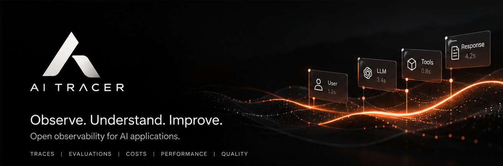

  

<h1 align="center">AITracer</h1>

  <strong>Trace, evaluate, and monitor your LLM applications.</strong>

  AITracer is an open-source observability platform for LLM applications — one place to understand every call, control your prompts, and ship with confidence.

---

## What is AITracer?

AITracer is an open-source AI engineering and LLM operations (LLMOps) platform, built for engineering teams that need to **build, monitor, evaluate, and debug LLM applications and autonomous AI agents**.

Traditional monitoring tools assume small, predictable code paths. LLM applications are different: they are non-deterministic, cost money per token, run slowly, and process huge multi-modal inputs. AITracer captures hierarchical traces of every step — user input, prompt templates, vector/RAG lookups, LLM calls, and tool executions — so you can see the exact timelines, token counts, and costs behind every response.

## Capabilities

| | |
| --- | --- |
| **Tracing** | Follow every LLM call through your whole stack with nested spans and full context. |
| **Observability** | Debug latency, cost, and quality issues with production-grade metrics and logs. |
| **Evaluations** | Score generations with LLM-as-a-judge and custom metrics to catch regressions. |
| **Prompt management** | Version, deploy, and roll back prompts without shipping code. |
| **Datasets** | Build test sets and run experiments against them before you release. |
| **Interactive playground** | Reproduce production failures and iterate on prompts and models. |
| **Analytics** | Centralized dashboards, actionable metrics, and automated alerts. |
| **Integrations** | OpenTelemetry, LangChain, LlamaIndex, OpenAI, MCP, CLI, and REST APIs. |

## Build AI systems you can understand, measure, and improve

From your first LLM integration to production-scale autonomous agents, AITracer gives your team the engineering visibility needed to ship more reliable, measurable, and maintainable AI applications.

---

  <a href="https://aitracer.app"><strong>Website</strong></a>
  ·
  <a href="https://aitracer.app/docs"><strong>Documentation</strong></a>

